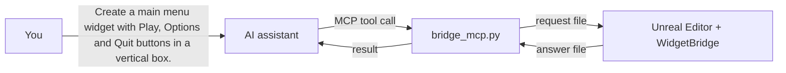

# Use WidgetBridge with an AI assistant

WidgetBridge ships with a small **MCP server** (`Mcp/bridge_mcp.py`). MCP is the standard way for AI assistants to use tools. Once it
is connected, your assistant sees the WidgetBridge commands and can call them itself while it talks with you.



## What you need

- The Unreal Editor open on your project, with WidgetBridge enabled.
- Python 3.9 or newer (`python --version` in a terminal). Nothing else to install.
- An assistant that can use local MCP servers: Claude Code, Claude Desktop, Cursor or OpenAI Codex.

In the examples below, replace `C:/Projects/MyGame` with your project folder (the folder that contains your `.uproject`).

## Claude Code

```
claude mcp add unreal -- python "C:/Projects/MyGame/Plugins/WidgetBridge/Mcp/bridge_mcp.py" --project "C:/Projects/MyGame"
```

Then start `claude` in any folder and ask: *"Create a main menu widget with Play, Options and Quit buttons in a vertical box."*

## Claude Desktop

Settings > Developer > Edit Config, then add to `claude_desktop_config.json`:

```json
{
  "mcpServers": {
    "unreal": {
      "command": "python",
      "args": ["C:/Projects/MyGame/Plugins/WidgetBridge/Mcp/bridge_mcp.py", "--project", "C:/Projects/MyGame"]
    }
  }
}
```

Restart Claude Desktop. The tools appear under the tools icon of the message box.

## Cursor

Cursor Settings > MCP (Tools & Integrations) > New MCP server, then the same block as Claude Desktop in `mcp.json`.

## OpenAI Codex

Add to `~/.codex/config.toml`:

```toml
[mcp_servers.unreal]
command = "python"
args = ["C:/Projects/MyGame/Plugins/WidgetBridge/Mcp/bridge_mcp.py", "--project", "C:/Projects/MyGame"]
```

## ChatGPT (browser or app)

Not supported: ChatGPT connects only to MCP servers reachable over the Internet, while this server runs on your computer next
to the editor. Use one of the assistants above.

## Things you can ask

- *Create a main menu widget with Play, Options and Quit buttons in a vertical box.*
- *In WBP_HUD, move the health bar to the top-left corner with 16 px of padding.*
- *My C++ class UI_Inventory has new BindWidget properties: add the missing widgets to WBP_Inventory.*
- *Copy the style of Button_Play to every other button of WBP_MainMenu.*
- *List every widget of WBP_HUD that is hidden.*

## Several Bridges

You only need **one** MCP server even if you own several Bridges: `bridge_mcp.py` finds every Bridge installed in the project
and exposes all their commands, prefixed by the Bridge name (`editor_start_pie`, `widget_add_child`...). Point the
configuration at any of the copies; they are identical.

## If the assistant says the tools fail

| Message | What to do |
|---|---|
| `Saved/... not found. Is the Unreal Editor open...` | Open the project in the Unreal Editor and wait until it has finished loading. |
| `No answer ... after N s` | The editor is busy (compiling shaders, a modal dialog). Wait, or close the dialog. |
| No tools appear | Check the path to `bridge_mcp.py` and that `python` works in a terminal. Run the command by hand: it should print `[bridge-mcp] project ..., N tool(s)` and wait. |
