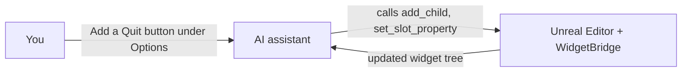

# WidgetBridge

**Build and edit your UMG menus by asking your AI assistant, or straight from your C++ classes.**

Laying out widget blueprints by hand is slow, and assistants that write your C++ cannot open the UMG designer. WidgetBridge lets
them create widget blueprints, add and arrange widgets, set styles and layout, and keep them in sync with your C++ classes.



## What you can ask

- *"Create a main menu widget with Play, Options and Quit buttons in a vertical box."*
- *"In WBP_HUD, move the health bar to the top-left corner with 16 px of padding."*
- *"My C++ class UI_Inventory has new BindWidget properties: add the missing widgets to WBP_Inventory."*
- *"Copy the style of Button_Play to every other button of WBP_MainMenu."*
- *"List every widget of WBP_HUD that is hidden."*

## Get started

1. Copy `WidgetBridge` into your project's `Plugins` folder (or install it from Fab) and open the project.
2. Connect your assistant: [Docs/AI-Assistants.md](Docs/AI-Assistants.md).
3. Ask.

## From C++, without an assistant

Declare your widgets in C++:

```cpp
UPROPERTY(meta = (BindWidget)) class UProgressBar* Progress_Health;
UPROPERTY(meta = (BindWidget)) class UTextBlock* Text_Value;
```

then type in the editor console:

```
WidgetBridge.Create UI_HealthBar /Game/UI WBP_HealthBar
```

The widget blueprint is created with both widgets in place. `WidgetBridge.Sync` adds the ones you declare later,
`WidgetBridge.Validate` reports what does not match, `WidgetBridge.Reverse` writes the C++ header of an existing blueprint.

## What it can do

30 commands: create, duplicate and reparent widget blueprints; add, rename, move, wrap and delete widgets; widget and slot
properties; copy styles and layout; named slots for master and child blueprints. Each one, with an example:
[Docs/Commands.md](Docs/Commands.md).

## Requirements

Unreal Engine 5.7, Windows 64-bit. For assistants: Python 3.9 or newer. Editor-only: nothing is added to packaged games.

Documentation: [Docs/README.md](Docs/README.md). Copyright (c) 2026 Fabien Lacaze, see `LICENSE.md`.
